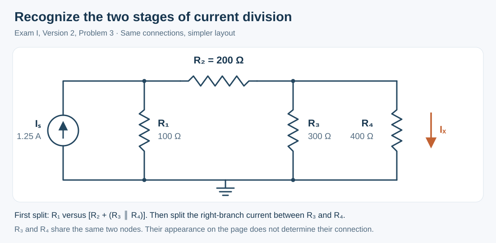
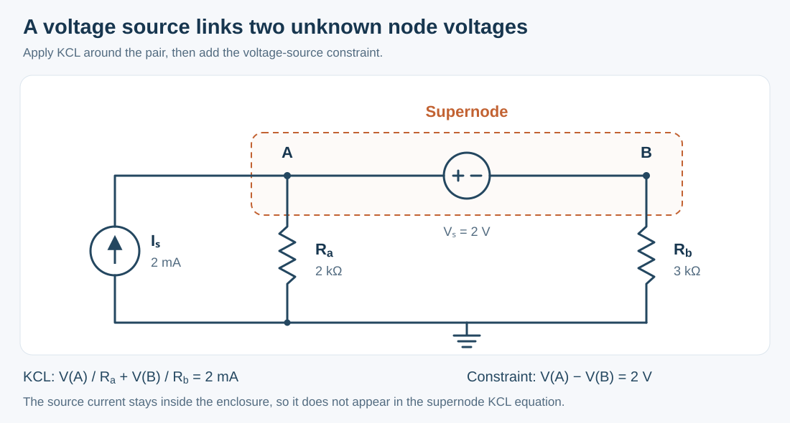
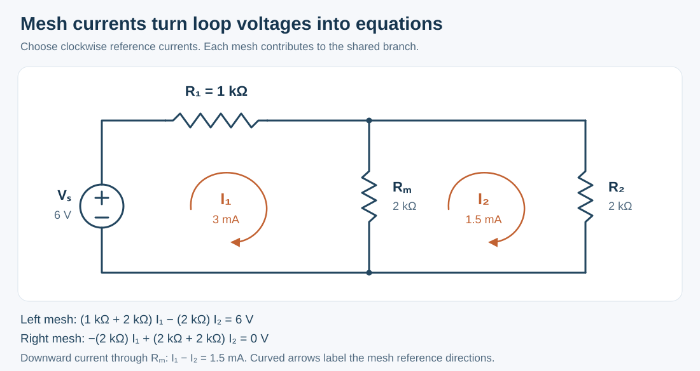
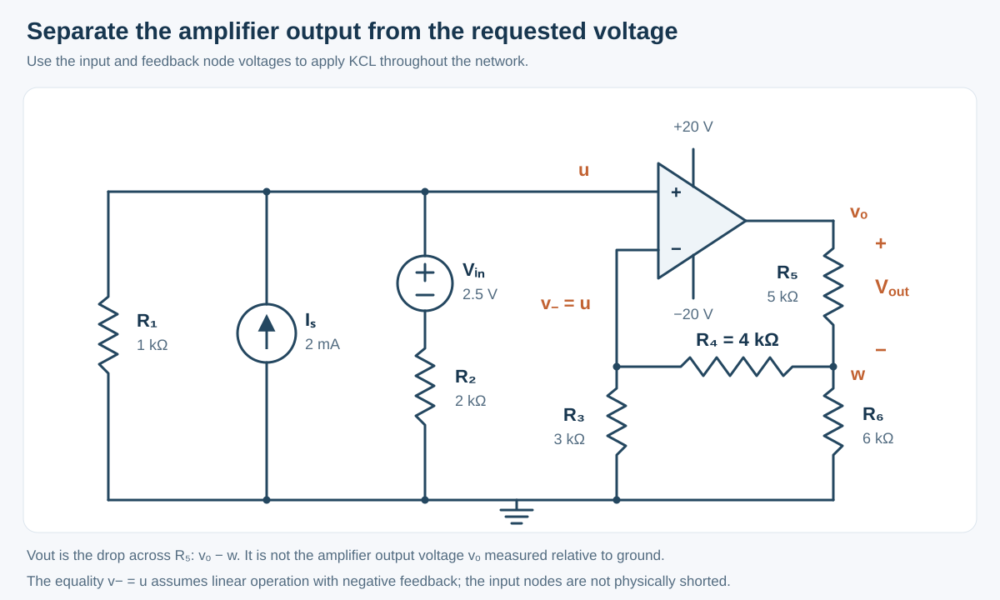
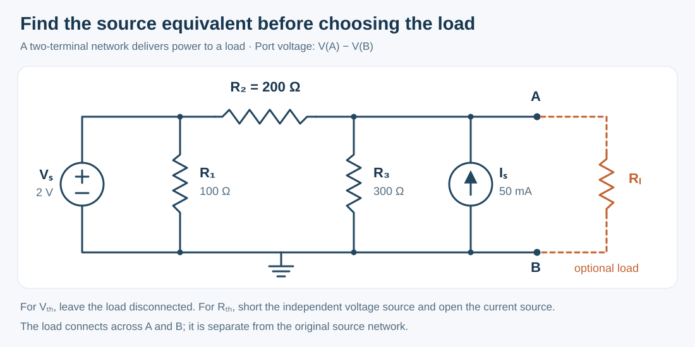

## Overview

EELE 201 introduces a way to describe circuits using voltages, currents, and energy. A circuit diagram becomes a set of equations when you identify its nodes, choose reference directions, and apply a few physical laws consistently.

This page develops those ideas step by step. Each method includes its assumptions, the reasoning behind its equations, and an example you can work through independently.

## Learning Path

| Concept | What you will learn to explain |
| --- | --- |
| Voltage, current, and power | How reference directions describe charge flow and energy transfer |
| Series and parallel networks | How connections determine which simplifications are valid |
| Nodal analysis | How charge conservation determines node voltages |
| Mesh analysis | How voltage relationships determine loop currents |
| Controlled sources | How one circuit variable controls another |
| Electrical measurements | How an instrument interacts with the circuit |
| Superposition | How independent sources contribute to a linear response |
| Op-amp feedback | How feedback establishes a useful voltage relationship |
| Equivalent circuits and load power | How a network behaves at a pair of terminals |
| First-order circuits | How stored energy determines a circuit's response over time |

## 1. Voltage, Current, and Power

**Current** is the rate of charge flow through a connection: $i=\mathrm{d}q/\mathrm{d}t$. **Voltage** is an energy difference per unit charge between two points. Voltage therefore always needs two reference points.

| Quantity | Symbol | Unit |
| --- | --- | --- |
| Charge | $q$ | Coulomb, $\text{C}$ |
| Current | $i$ | Ampere, $\text{A}=\text{C/s}$ |
| Voltage | $v$ | Volt, $\text{V}=\text{J/C}$ |
| Resistance | $R$ | Ohm, $\Omega=\text{V/A}$ |
| Power | $p$ | Watt, $\text{W}=\text{J/s}$ |

Choose a reference node and call its voltage zero. A node voltage $V_A$ means the voltage from A to that reference; the voltage between A and B is $V_{AB}=V_A-V_B$. Ground establishes this reference and can be drawn at any convenient node.

### Reference Directions and Ohm's Law

Draw a current arrow and mark a voltage polarity before calculating. Under the **passive sign convention**, the reference current enters the positive voltage terminal. A linear resistor then obeys

:::reference Ohm's law
$$
v=iR
$$

- `v`: voltage across the resistor, in volts.
- `i`: current entering its positive terminal, in amperes.
- `R`: resistance, in ohms.

For a linear resistor, using the passive sign convention.
:::

A negative current means the actual current flows opposite to the arrow. A negative voltage means the marked positive terminal is at the lower potential. Both are useful descriptions of the circuit.

An ideal voltage source maintains a specified voltage, with its current determined by the connected circuit. An ideal current source maintains a specified current, with its voltage determined by the connected circuit.

### Power Describes Energy Transfer

With the passive sign convention:

$$
p=vi
$$

Positive power means absorption, and negative power means supply. A $4\,\text{V}$ source carrying $0.232\,\text{A}$ into its positive terminal absorbs $0.928\,\text{W}$. If the current reverses, its signed power becomes $-0.928\,\text{W}$ and it supplies that amount of power.

For a positive resistance:

$$
p_R=i^2R=\frac{v^2}{R}\geq0
$$

Resistors dissipate energy. Across a complete circuit, the signed powers of all elements sum to zero: the total supplied power equals the total absorbed power.

## 2. Connections, Resistance, and Dividers

A **node** contains every point joined by ideal wire. All those points share the same voltage. Trace the wires before deciding how components combine.

Two resistors are in series when their shared node has no other current path, so both carry the same current. They are in parallel when both ends connect to the same two nodes, so both have the same voltage.

$$
R_{\text{series}}=R_a+R_b, \qquad R_a\parallel R_b=\frac{R_aR_b}{R_a+R_b}
$$

These relationships follow from Ohm's law: series voltage drops add, while parallel branch currents add. For several parallel resistors, $1/R_{\text{eq}}=\sum_k1/R_k$.

### Voltage Division

Connect $R_1$ from an ideal input voltage to an output node, and $R_2$ from that node to ground. With no additional load, the common current is $I=V_{\text{in}}/(R_1+R_2)$, so

$$
V_{\text{out}}=IR_2=V_{\text{in}}\frac{R_2}{R_1+R_2}
$$

A load connected across $R_2$ changes the lower resistance to $R_2\parallel R_L$. Use that combination in the divider formula to include the load's effect.

### Current Division

For two parallel resistors carrying a total current $I$, use the common voltage to write $I=V/R_a+V/R_b$. Solving for the current through $R_a$ gives

$$
I_a=I\frac{R_b}{R_a+R_b}
$$

The lower-resistance branch carries more current. This also explains why the other branch's resistance appears in the numerator.

### Example: Simplify One Level at a Time

A $1.25\,\text{A}$ source feeds the network below. The resistors are $R_1=100\,\Omega$, $R_2=200\,\Omega$, $R_3=300\,\Omega$, and $R_4=400\,\Omega$. Find the downward current through $R_4$.

First combine $R_3$ and $R_4$:

$$
R_{34}=300\parallel400=171.4286\,\Omega
$$

The current through the series branch containing $R_2$ is

$$
I_{234}=1.25\frac{100}{100+200+171.4286}\approx0.2651515\,\text{A}
$$

Then divide that branch current:

$$
I_x=I_{234}\frac{300}{300+400}\approx0.1136364\,\text{A}
$$

A useful check is that $I_x<I_{234}<1.25\,\text{A}$: each split sends only part of the incoming current into that branch.

## 3. Kirchhoff's Laws and Nodal Analysis

Kirchhoff's current law, **KCL**, expresses charge conservation at a node: current entering equals current leaving. Kirchhoff's voltage law, **KVL**, states that the signed voltage changes around a lumped-circuit loop sum to zero.

Nodal analysis uses KCL with node voltages as unknowns. For a resistor from A to B, the current leaving A is

$$
i_{A\rightarrow B}=\frac{V_A-V_B}{R}
$$

Choose a reference node, label the remaining voltages, and express every resistor current this way. Use one consistent sign convention when adding the currents at each node.

### Why a Voltage Source Creates a Supernode

A voltage source fixes the difference between its terminal voltages. Its current is an additional unknown, so a resistor-style current expression is unavailable.

When the source connects two nonreference nodes, enclose both nodes in a **supernode**. Write KCL using currents crossing the enclosure, then add the source's voltage constraint. The source's internal current cancels from the combined KCL equation.

### Example: Two Unknown Voltages

Node A connects to ground through $R_a=2\,\text{k}\Omega$, and B connects to ground through $R_b=3\,\text{k}\Omega$. A $2\,\text{V}$ source has its positive terminal at A and negative terminal at B. A $2\,\text{mA}$ current source injects current into A.

The two independent equations are

$$
\frac{V_A}{2000\,\Omega}+\frac{V_B}{3000\,\Omega}=2\,\text{mA}
$$

$$
V_A-V_B=2\,\text{V}
$$

Substitute $V_A=V_B+2\,\text{V}$ into KCL to obtain $V_B=1.2\,\text{V}$ and $V_A=3.2\,\text{V}$. The resistor currents are $1.6\,\text{mA}$ and $0.4\,\text{mA}$, which add to the injected $2\,\text{mA}$.

The unknowns need a sufficient set of independent equations. Repeating a KCL equation in a different algebraic form adds no new information.

## 4. Mesh Analysis and Shared Currents

A **mesh** is a loop that encloses no smaller loop in a planar circuit. Assign a reference mesh current to each mesh and apply KVL. Choosing all mesh currents clockwise often makes the bookkeeping easier.

A mesh current is a calculation variable. In a branch shared by two meshes, the actual branch current is the algebraic combination of their mesh currents.

### Example: Two Meshes Share a Resistor

The circuit below has $V_S=6\,\text{V}$, $R_1=1\,\text{k}\Omega$, and $R_m=R_2=2\,\text{k}\Omega$. Both mesh currents are defined clockwise.

The downward current through $R_m$ is $I_1-I_2$. Applying KVL to the two meshes gives

$$
(R_1+R_m)I_1-R_mI_2=V_S
$$

$$
-R_mI_1+(R_m+R_2)I_2=0
$$

The second equation gives $I_2=I_1/2$. Substitution into the first gives $I_1=3\,\text{mA}$ and $I_2=1.5\,\text{mA}$. Therefore $R_m$ carries $1.5\,\text{mA}$ downward, and the central node is at $3\,\text{V}$.

You can check the answer through network reduction: $R_m\parallel R_2=1\,\text{k}\Omega$, so the source sees $2\,\text{k}\Omega$ and supplies $3\,\text{mA}$.

### Current Sources and Supermeshes

A current source on the boundary of one mesh fixes that mesh current, with a sign set by its arrow. When a current source lies between two meshes, form a **supermesh**: apply KVL around the outside boundary and add a constraint relating the two mesh currents to the source current. For compatible reference directions, that constraint can take the form $I_1-I_2=I_S$.

Nodal and mesh analysis describe the same circuit. Choose the method that makes the source constraints and unknowns easiest to express.

## 5. Controlled Sources

A controlled source models a voltage or current that depends on another circuit variable. The diamond symbol identifies the source; the controlling variable can be measured elsewhere in the circuit.

| Source type | Relationship | Gain units |
| --- | --- | --- |
| Voltage-controlled voltage source | $v=\mu v_x$ | Dimensionless |
| Current-controlled voltage source | $v=r_m i_x$ | $\text{V/A}=\Omega$ |
| Voltage-controlled current source | $i=g_m v_x$ | $\text{A/V}=\text{S}$ |
| Current-controlled current source | $i=\beta i_x$ | Dimensionless |

The relationship determines the gain's units. A parameter named $G$ could represent different gains in different models; check the equation that defines it.

### Express the Control Variable in the Chosen Unknowns

If $i_x$ is defined from D to E through a resistor, substitute $i_x=(V_D-V_E)/R$ into the controlled-source equation. This keeps a nodal system expressed entirely in node voltages.

For example, a current source directed from C into A with value $\beta i_x$ contributes $-\beta(V_D-V_E)/R$ to a KCL equation that sums currents leaving A.

### Example: Voltage-to-Current Gain

An ideal controlled current source injects $i=g_m v_x$ upward into a node with a $1\,\text{k}\Omega$ resistor to ground. Let $g_m=0.015\,\text{A/V}$. KCL gives

$$
\frac{v_{\text{out}}}{R_L}=g_m v_x, \qquad v_{\text{out}}=g_mR_Lv_x
$$

The voltage gain is $g_mR_L=15$. An input of $0.20\,\text{V}$ produces $3.0\,\text{V}$; an input of $-0.20\,\text{V}$ produces $-3.0\,\text{V}$. The signs follow from the source arrow and the marked control voltage.

Keep controlled sources active when applying superposition or finding equivalent resistance. Their values continue to follow their controlling variables.

## 6. Measurements and Loading

A measurement instrument becomes part of the circuit. Begin with its electrical model, then identify how its connections affect the network.

| Instrument | Ideal model | Positive reading |
| --- | --- | --- |
| Voltmeter | Infinite resistance; zero current | Voltage at V terminal relative to COM |
| Ammeter | Zero resistance; zero voltage drop | Current entering A and leaving COM |

An ideal voltmeter connected across a component leaves the circuit currents unchanged. Placing it in series opens that current path. A real voltmeter has finite input resistance, which appears in parallel with the measured branch and can change its voltage.

An ideal ammeter placed in series adds no voltage drop. Across a resistor, it creates a short circuit that bypasses the resistor.

### Example: The Connection Changes the Current

A $6\,\text{V}$ source drives $1\,\text{k}\Omega$ and $2\,\text{k}\Omega$ in series. The original current is $6\,\text{V}/3\,\text{k}\Omega=2\,\text{mA}$.

Connecting an ideal ammeter across the $2\,\text{k}\Omega$ resistor bypasses it. The source now sees only $1\,\text{k}\Omega$, so the meter carries $6\,\text{mA}$. With current entering its A terminal, the display is positive; reversing the leads makes it $-6\,\text{mA}$.

The meter reports the current in the circuit formed by its actual connections. Redraw that circuit before interpreting a reading.

## 7. Superposition in Linear Circuits

A linear circuit's voltage or current response is the sum of the contributions from its independent sources. To isolate a contribution, set the other independent sources to zero:

- A zero-volt ideal voltage source becomes a short circuit.
- A zero-ampere ideal current source becomes an open circuit.
- Controlled sources retain their defining relationships.

The resistors remain connected when a source is set to zero.

### Example: Two Voltage Sources and One Current Source

A node at voltage $V$ has four connections:

| Connection | Branch description |
| --- | --- |
| Source $V_{S1}=6\,\text{V}$ | Connected to the node through $R_1=1\,\text{k}\Omega$ |
| Source $V_{S2}=3\,\text{V}$ | Connected to the node through $R_2=2\,\text{k}\Omega$ |
| Ground | Connected through $R_3=2\,\text{k}\Omega$ |
| Current source $I_S=1\,\text{mA}$ | Injects current from ground into the node |

Both voltage sources are measured positive relative to ground. KCL gives

$$
\frac{V-V_{S1}}{R_1}+\frac{V-V_{S2}}{R_2}+\frac{V}{R_3}=I_S
$$

Collecting the voltage terms yields

$$
V=\frac{V_{S1}/R_1+V_{S2}/R_2+I_S}{1/R_1+1/R_2+1/R_3}
$$

Each numerator term represents one source's contribution. With these resistances:

$$
V=0.50V_{S1}+0.25V_{S2}+(500\,\Omega)I_S
$$

| Active source | Contribution |
| --- | --- |
| $V_{S1}$ alone | $3.00\,\text{V}$ |
| $V_{S2}$ alone | $0.75\,\text{V}$ |
| $I_S$ alone | $0.50\,\text{V}$ |

Adding them gives $V=4.25\,\text{V}$. Voltage-source coefficients are dimensionless, while a coefficient multiplying a current to produce a voltage has units of resistance.

Power depends on products or squares of circuit variables. First combine the voltage or current contributions, then calculate the power from the combined result.

## 8. Ideal Op-Amps and Negative Feedback

An op-amp responds to the difference between its input voltages: $v_o=A(v_+-v_-)$. When negative feedback keeps an amplifier with very large gain in its linear operating range, a finite output requires a very small input difference.

The ideal linear-feedback model therefore uses

$$
i_+=i_-=0, \qquad v_+=v_-
$$

Zero input current follows from infinite input resistance. The equal voltages describe the feedback condition; the input terminals remain electrically separate. Check the amplifier's output against its supply rails after solving.

### Familiar Feedback Connections

| Configuration | Connections | Output relationship |
| --- | --- | --- |
| Voltage follower | Output connects to the inverting input; signal drives the noninverting input | $v_o=v_{\text{in}}$ |
| Inverting amplifier | Noninverting input grounded; input through $R_{\text{in}}$ and output through $R_f$ meet at the inverting input | $v_o=-(R_f/R_{\text{in}})v_{\text{in}}$ |
| Noninverting amplifier | Signal drives the noninverting input; $R_f$ connects output to inverting input, and $R_g$ connects that input to ground | $v_o=(1+R_f/R_g)v_{\text{in}}$ |

For the inverting amplifier, the inverting node is at zero volts under linear feedback. KCL there gives $v_{\text{in}}/R_{\text{in}}+v_o/R_f=0$, which produces the gain formula.

### Example: Analyze a Feedback Network with KCL

In the circuit below, $u$ is the noninverting input voltage, $w$ is the junction of $R_4$, $R_5$, and $R_6$, and $v_o$ is the amplifier output relative to ground. The marked voltage across $R_5$ is $V_{\text{out}}=v_o-w$.

The branch containing $V_{\text{in}}$ and $R_2$ forms a supernode with $u$. Zero input current gives

$$
\frac{u}{1000\,\Omega}+\frac{u-2.5\,\text{V}}{2000\,\Omega}=2\,\text{mA}
$$

Therefore $u=13/6\,\text{V}$. The inverting input is also at $u$, so KCL there gives

$$
\frac{u}{R_3}+\frac{u-w}{R_4}=0
$$

Hence $w=(1+R_4/R_3)u=91/18\,\text{V}$. The current through $R_5$ supplies both the $R_4$ and $R_6$ branches:

$$
V_{\text{out}}=R_5\left(\frac{w-u}{R_4}+\frac{w}{R_6}\right)\approx7.824074\,\text{V}
$$

The amplifier output is $v_o=w+V_{\text{out}}\approx12.87963\,\text{V}$, within the $\pm20\,\text{V}$ rails. The current drawn through $R_4$ explains why $R_5$ and $R_6$ require a loaded-network calculation.

## 9. Thevenin and Norton Equivalent Circuits

An equivalent circuit preserves the voltage-current relationship seen at a pair of terminals. It lets you analyze a changing load without repeatedly solving the entire source network.

Define $v=V_A-V_B$ and let $i_L$ leave A and flow through the external load toward B. A linear resistive port can be written as

$$
v=V_{\text{TH}}-R_{\text{TH}}i_L
$$

The **Thevenin model** realizes this relationship with a voltage source in series with $R_{\text{TH}}$. The **Norton model** uses a current source in parallel with the same resistance.

### Finding the Model

1. Disconnect the external load. The open-circuit voltage is $V_{\text{TH}}=V_A-V_B$.
2. Set independent sources to zero and find the resistance seen from A-B.
3. When controlled sources are present, keep them active and apply a test source if needed. With test current entering the network's A terminal, $R_{\text{TH}}=v_{\text{test}}/i_{\text{test}}$.

A source-free resistor network can usually be reduced directly. A network containing only controlled sources can still have a nonzero equivalent resistance, even when its open-circuit voltage and short-circuit current are both zero.

### Example: Replace a Two-Source Network

In the network below, take B as ground and leave the dashed load disconnected. The $2\,\text{V}$ source fixes the left node voltage; the $50\,\text{mA}$ source injects current into A.

KCL at A gives

$$
\frac{V_A-2\,\text{V}}{200\,\Omega}+\frac{V_A}{300\,\Omega}=0.05\,\text{A}
$$

Thus $V_{\text{TH}}=7.2\,\text{V}$. Shorting the independent voltage source bypasses $R_1$, and opening the current source leaves

$$
R_{\text{TH}}=R_2\parallel R_3=120\,\Omega
$$

The external short-circuit current, referenced from A to B, is

$$
I_{\text{SC}}=\frac{V_{\text{TH}}}{R_{\text{TH}}}=60\,\text{mA}
$$

The Norton source uses a $60\,\text{mA}$ arrow from B to A, supplying the external short from A to B, in parallel with $120\,\Omega$.

Keep terminal labels and current references consistent when a result is negative. A negative $I_{\text{SC}}$ means the external short current flows opposite to its chosen A-to-B reference.

## 10. Load Power and Resistance Matching

Connect a resistor $R_L$ to a Thevenin source with $R_{\text{TH}}>0$. The series circuit gives

$$
I_L=\frac{V_{\text{TH}}}{R_{\text{TH}}+R_L}, \qquad V_L=I_LR_L
$$

Using $P_L=I_L^2R_L$:

$$
P_L=\frac{V_{\text{TH}}^2R_L}{(R_{\text{TH}}+R_L)^2}
$$

A very small load resistance has little voltage across it, while a very large load resistance draws little current. Load power reaches a maximum between those limits:

$$
R_{L,\text{opt}}=R_{\text{TH}}, \qquad P_{L,\max}=\frac{V_{\text{TH}}^2}{4R_{\text{TH}}}
$$

:::details Derive the matching condition
For positive load resistance, differentiate the power expression:

$$
\frac{\mathrm{d}P_L}{\mathrm{d}R_L}=\frac{V_{\text{TH}}^2(R_{\text{TH}}-R_L)}{(R_{\text{TH}}+R_L)^3}
$$

The derivative is positive below $R_{\text{TH}}$ and negative above it. The turning point at $R_L=R_{\text{TH}}$ is therefore a maximum for a nonzero source voltage.
:::

For the $7.2\,\text{V}$, $120\,\Omega$ equivalent above:

| Load | Load voltage | Load power |
| --- | --- | --- |
| $120\,\Omega$ | $3.60\,\text{V}$ | $108\,\text{mW}$ |
| $1000\,\Omega$ | $6.42857\,\text{V}$ | $41.3265\,\text{mW}$ |

At a matched load, the load and the equivalent internal resistance dissipate equal power. The matching condition describes maximum load power; power efficiency also depends on the internal dissipation.

## 11. Stored Energy and First-Order Response

A capacitor stores energy in an electric field, while an inductor stores energy in a magnetic field. Under the passive sign convention:

$$
i_C=C\frac{\mathrm{d}v_C}{\mathrm{d}t}, \qquad v_L=L\frac{\mathrm{d}i_L}{\mathrm{d}t}
$$

$$
W_C=\frac{1}{2}Cv_C^2, \qquad W_L=\frac{1}{2}Li_L^2
$$

A finite capacitor current produces a finite rate of voltage change. A finite inductor voltage produces a finite rate of current change. Consequently, with non-impulsive switching signals:

$$
v_C(0^+)=v_C(0^-), \qquad i_L(0^+)=i_L(0^-)
$$

### Initial Value, Final Value, and Time Constant

For a stable first-order circuit with constant sources after switching, the capacitor voltage or inductor current follows

$$
x(t)=x(\infty)+\left[x(0^+)-x(\infty)\right]e^{-t/\tau}, \qquad t\geq0
$$

The difference from the final value decays exponentially. Its rate is set by

$$
\tau_{RC}=R_{\text{eq}}C, \qquad \tau_{RL}=\frac{L}{R_{\text{eq}}}
$$

Find $R_{\text{eq}}$ looking into the storage element's terminals in the circuit after switching, with independent sources deactivated and controlled sources retained. Use the initial circuit to find $v_C(0^-)$ or $i_L(0^-)$, then apply continuity. In the final DC steady state, an ideal capacitor is open and an ideal inductor is short.

### Example: Charging a Capacitor

An initially discharged $100\,\mu\text{F}$ capacitor is connected to an ideal $5\,\text{V}$ source through $1\,\text{k}\Omega$. Its other terminal is grounded. The initial voltage is zero, the final voltage is $5\,\text{V}$, and $\tau=RC=0.10\,\text{s}$:

$$
v_C(t)=5\left(1-e^{-t/(0.10\,\text{s})}\right)\,\text{V}
$$

After one time constant, $v_C\approx3.16\,\text{V}$. After five, it is approximately $4.97\,\text{V}$. The charging current starts at $5\,\text{mA}$ and approaches zero as the capacitor voltage approaches the source voltage.

## Check Your Understanding

:::quiz choice
An ideal ammeter carries $125\,\text{mA}$ into COM and out of its A terminal. What does it display?

- [ ] $+125\,\text{mA}$
- [x] $-125\,\text{mA}$
- [ ] $0\,\text{mA}$

---

The positive current reference enters A and leaves COM. The stated current has the opposite direction, producing a negative reading.
:::

:::quiz numeric answer=4.25 unit=V tolerance=0.001
A linear network has $V=0.50V_{S1}+0.25V_{S2}+(500\,\Omega)I_S$. Find $V$ for $V_{S1}=6\,\text{V}$, $V_{S2}=3\,\text{V}$, and $I_S=1\,\text{mA}$.

---

Each source contributes a voltage: $3.00+0.75+0.50=4.25\,\text{V}$. The resistance coefficient converts the current contribution to volts.
:::

:::quiz numeric answer=0.108 unit=W tolerance=0.0001
A port has $V_{\text{TH}}=7.2\,\text{V}$ and $R_{\text{TH}}=120\,\Omega$. What maximum power can a matched resistive load receive?

---

The matched load is $120\,\Omega$. Its power is $7.2^2/(4\times120)=0.108\,\text{W}$, or $108\,\text{mW}$.
:::

To check a circuit model, verify a physical relationship as well as the arithmetic: currents should satisfy KCL, voltage changes should satisfy KVL, signed powers should balance, and a transient expression should reproduce its initial and final values.

## Related Notes

- [Resistive Voltage Divider](../../notes/voltage-divider.html)
- [Circuits II](../../notes/circuits-ii.html)
- [Physics II](../../notes/physics-ii.html)
