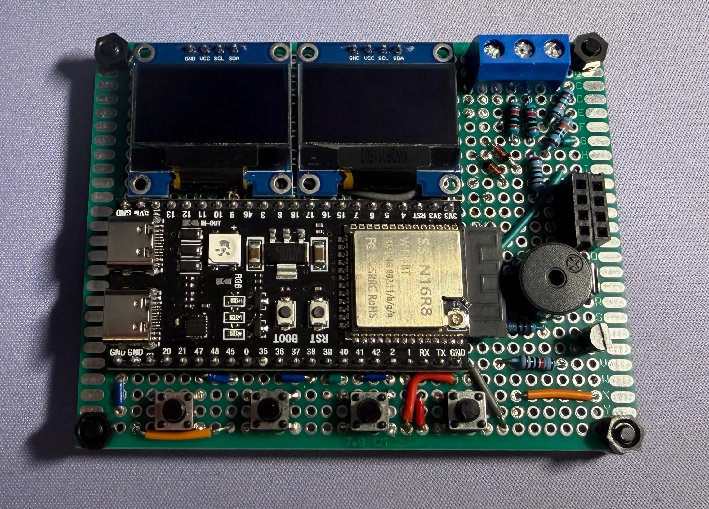
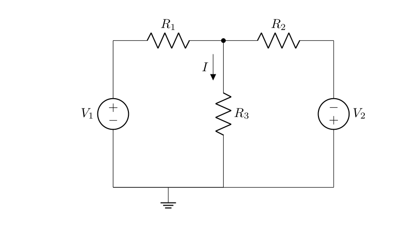

## Start here

This is a live, copyable guide to writing articles on this website. Each example pairs **Markdown source** with its **rendered result**. Use the download buttons above to save this guide or a shorter article starter.

The article supports the rich text you expect in a chat response: readable explanations, highlighted code, equations, tables, diagrams, PDF cards, expandable answers, and interactive quizzes. It publishes your writing as an article; it does not generate AI responses or create a chat conversation.

> [!TIP] A useful teaching sequence
> State the learning goal, explain one idea, work through an example, and finish with a question the reader can try.

## Headings and navigation

The HTML page supplies the article title. Start Markdown sections with `##`, then use `###` through `######` for progressively smaller subsections. A source `#` heading is displayed as H2 so the page keeps a single H1.

**Source**

```markdown
## A major section
### A subsection
#### A smaller subsection
##### A supporting detail
###### A final detail
```

**Result**

### A subsection

#### A smaller subsection

##### A supporting detail

###### A final detail

This section's “Headings and navigation” title is a live H2 example. The automatic section navigation and reading progress use major sections. Select a section in the navigation, then copy the browser URL to share it. Headings keep their IDs for `#heading-id` links; repeated heading names receive distinct IDs.

## Paragraphs and emphasis

Separate paragraphs with a blank line. A normal newline continues the same paragraph; two spaces at the end of a line force a line break.

**Source**

```markdown
**Voltage** and __current__ are related.
*Explain the idea* before _substituting values_.
~~The first estimate~~ The revised estimate is 2.5 V.

First measurement: 2.48 V.  
Second measurement: 2.51 V.

This is a new paragraph.
```

**Result**

**Voltage** and __current__ are related. *Explain the idea* before _substituting values_. ~~The first estimate~~ The revised estimate is 2.5 V.

First measurement: 2.48 V.  
Second measurement: 2.51 V.

This is a new paragraph.

## Inline code and literal symbols

Use backticks for filenames, variables, commands, or literal Markdown. Use a pair of backticks when the content itself contains a backtick. Escape punctuation with a backslash when you want the symbol to appear literally.

**Source**

```markdown
Open `js/main.js` and inspect `readVoltage()`.
The literal syntax `**bold**` remains unchanged inside code.
Write `` `pin` `` to show a backtick inside code.
\*This is literal text\*, and \$5 is a price.
```

**Result**

Open `js/main.js` and inspect `readVoltage()`. The literal syntax `**bold**` remains unchanged inside code. Write `` `pin` `` to show a backtick inside code. \*This is literal text\*, and \$5 is a price.

## Links and references

Inline links keep the destination next to the label. Reference links move repeated URLs out of the paragraph. A bare web address becomes a link automatically. Use a `#heading-id` fragment for links within the current article.

**Source**

```markdown
Browse the [Resources library](../../resources.html).
Read the [voltage-divider note][divider].
Visit https://github.com/gnojun.
Jump to [the teaching starter](#a-complete-teaching-starter).

[divider]: ../../notes/voltage-divider.html "Worked circuit example"
```

**Result**

Browse the [Resources library](../../resources.html). Read the [voltage-divider note][divider]. Visit https://github.com/gnojun. Jump to [the teaching starter](#a-complete-teaching-starter).

[divider]: ../../notes/voltage-divider.html "Worked circuit example"

Relative file URLs resolve from the Markdown file's folder. A `#heading-id` link stays on this HTML article. Use ordinary web, email, or local file links; executable URL schemes are rejected.

## Lists and numbered steps

Indent nested items consistently. Numbered lists can start at a value other than one, which is useful when continuing a lab procedure.

**Source**

```markdown
- Record the input.
  - Include the unit.
  - State the measurement range.
- Calculate the output.
  1. Substitute the values.
  2. Check the result.

7. Save the calculation.
8. Compare it with a measurement.
```

**Result**

- Record the input.
  - Include the unit.
  - State the measurement range.
- Calculate the output.
  1. Substitute the values.
  2. Check the result.

7. Save the calculation.
8. Compare it with a measurement.

## Task lists

Task lists display progress from your source file. They are read-only in the published article: change `[ ]` to `[x]` in Markdown to mark a task complete.

**Source**

```markdown
- [x] Define the learning goal.
- [x] Add a worked example.
- [ ] Review the explanation on a phone.
```

**Result**

- [x] Define the learning goal.
- [x] Add a worked example.
- [ ] Review the explanation on a phone.

## Quotations and separators

Use `>` for a quotation or an aside, a quoted blank line for another paragraph, and `>>` for a nested quotation. A line containing `---` separates two ideas.

**Source**

```markdown
> Explain what the result means.
>
> A number is more useful when its assumptions are visible.
>
> > What changes if the load resistance decreases?

---

The next idea begins here.
```

**Result**

> Explain what the result means.
>
> A number is more useful when its assumptions are visible.
>
> > What changes if the load resistance decreases?

---

The next idea begins here.

## Code blocks

Use at least three backticks or tildes around a code block. Put the language after the opening fence and optionally add `title="filename"`. The title is a label, so it does not create or download a file.

**Source**

````markdown
```cpp title="divider.cpp"
constexpr double vin = 5.0;
constexpr double r1 = 10000.0;
constexpr double r2 = 10000.0;
double vout = vin * r2 / (r1 + r2);
```
````

**Result**

```cpp title="divider.cpp"
constexpr double vin = 5.0;
constexpr double r1 = 10000.0;
constexpr double r2 = 10000.0;
double vout = vin * r2 / (r1 + r2);
```

Use **Copy** to copy the original code and **Wrap** to switch long lines between wrapping and horizontal scrolling. Highlighting supports common languages including JavaScript, Python, C++, Bash, JSON, HTML/XML, and CSS. An unknown language is displayed as plain text. Code remains selectable if clipboard access is unavailable.

### Longer fences and tildes

To teach code-fence syntax, use a longer outer fence than the one you want to display. This page uses four backticks around examples containing triple backticks.

**Source**

````markdown
~~~text title="example.txt"
This is a tilde-fenced block.
The text **stays literal**.
~~~
````

**Result**

~~~text title="example.txt"
This is a tilde-fenced block.
The text **stays literal**.
~~~

## Tables

The separator row controls column alignment: `:---` is left aligned, `:---:` is centered, and `---:` is right aligned. Escape a pipe with `\|`, including inside inline code in a table cell.

**Source**

```markdown
| Item | Setting | Value |
| :--- | :---: | ---: |
| Input | `vin` | 5.0 V |
| Divider | Equal resistors | 2.5 V |
| Literal pipe | `mode \| flags` | — |
```

**Result**

| Item | Setting | Value |
| :--- | :---: | ---: |
| Input | `vin` | 5.0 V |
| Divider | Equal resistors | 2.5 V |
| Literal pipe | `mode \| flags` | — |

Use **Copy table** to copy tab-separated values into a spreadsheet. Wide tables scroll horizontally on small screens.

## Inline equations

Write LaTeX between `$...$` or `\(...\)` to place an equation inside a sentence. Put names and units in `\text{...}` when they should use upright text.

**Source**

```markdown
Ohm's law is $V = IR$.
For an ideal divider, \(V_{\text{out}} = V_{\text{in}} / 2\)
when the resistors are equal.
```

**Result**

Ohm's law is $V = IR$. For an ideal divider, \(V_{\text{out}} = V_{\text{in}} / 2\) when the resistors are equal.

## Display equations

Put `$$` or `\[` and `\]` on separate lines for a centered equation. KaTeX loads when an article needs math. Long expressions can scroll horizontally.

**Source**

```latex
$$
V_{\text{out}} = V_{\text{in}}\frac{R_2}{R_1 + R_2}
$$

\[
\begin{aligned}
V_{\text{out}} &= 5\frac{10}{10 + 10} \\
                &= 2.5\,\text{V}
\end{aligned}
\]
```

**Result**

$$
V_{\text{out}} = V_{\text{in}}\frac{R_2}{R_1 + R_2}
$$

\[
\begin{aligned}
V_{\text{out}} &= 5\frac{10}{10 + 10} \\
                &= 2.5\,\text{V}
\end{aligned}
\]

## Images, captions, and zoom

Use descriptive alternative text for the image and an optional quoted title for its caption. Image paths resolve relative to this `.md` file. Put an image in its own paragraph to display it as a figure; click or tap the figure to open its larger view.

**Source**

```markdown

```

**Result**


### Black-and-white diagrams in both themes

The existing `.diagram.svg` naming convention opts a picture into automatic theme adaptation. It also works with `.diagram.png`, `.diagram.jpg`, `.diagram.jpeg`, `.diagram.webp`, `.diagram.gif`, and `.diagram.avif`. Save one image with black lines and text on a white or transparent background, then include `.diagram` immediately before its file extension.

In light mode, the original image is displayed. In dark mode, the same image is inverted with CSS (`invert(1) brightness(1.15)`, at 92% opacity): black lines become light and a white background becomes dark. The website's theme button changes `data-theme` on the page, so both the article image and its larger preview update immediately. You do not need a second image file or a different Markdown path for each theme. The source file itself is never modified.

This is a filename convention, so the site does not inspect whether an image is actually black and white. Reserve it for monochrome diagrams; color photos and plots would also have their colors inverted. Ordinary photos use the same Markdown syntax without `.diagram` in the filename:

```markdown

```


## PDF cards and previews

Use a `:::pdf` block to generate a PDF card with a title, description, **open in a new tab** and **download** links, and a collapsed preview. Keep the card in the Markdown file; no page-specific HTML is needed.

**Source**

```markdown
:::pdf src="../../files/courses/phsx220/practice-exam-a.pdf" title="Practice Exam A" download="220-Final Exam-Practice Exam A.pdf"

12 pages: questions on pages **1-6**; supplied solutions on pages **7-12**.
:::
```

**Result**

:::pdf src="../../files/courses/phsx220/practice-exam-a.pdf" title="Practice Exam A" download="220-Final Exam-Practice Exam A.pdf"

12 pages: questions on pages **1-6**; supplied solutions on pages **7-12**.
:::

| Setting | Required? | Meaning |
| --- | --- | --- |
| `src` | Yes | PDF URL or a path relative to this Markdown file. The URL pathname must end in `.pdf`; query parameters and fragments are allowed. |
| `title` | No | Card title. Defaults to the PDF filename. |
| `download` | No | Suggested filename when downloading. Defaults to the filename in the PDF URL. |

Write settings as `name=value` pairs on the opening line. Use double or single quotes around values containing spaces. The body supports ordinary Markdown, including emphasis, lists, and equations. Close the block with `:::`.

The shortest form uses only a source:

```markdown
:::pdf src="../../files/courses/phsx220/practice-exam-a.pdf"
:::
```

PDF URLs can use HTTP or HTTPS. Preview support varies by browser, so the direct open and download links remain available outside the preview. For PDFs hosted on another website, download behavior depends on that host and the browser.

Invalid or missing settings display an authoring error without creating active PDF links or a preview. Raw HTML in the description remains escaped, just as it does elsewhere in the article.

## Callouts and project status

Start a blockquote with `> [!TYPE]`. An optional title follows the type. Keep `>` on each line, including blank lines, to preserve paragraphs and lists inside the callout.

**Source**

```markdown
> [!NOTE] Define the assumption
> The calculation uses an ideal, unloaded divider.
>
> - The input is constant.
> - Both resistors have their nominal values.

> [!TIP] Explain the next step
> Compare the prediction with your measurement.

> [!IMPORTANT] Include units
> State whether resistance is in ohms or kilo-ohms.

> [!WARNING] Check the range
> Review the permitted input range before connecting a sensor.

> [!CAUTION] Change one variable
> Record the original setting before changing the circuit.

> [!IMPLEMENTED] Available now
> The article includes a worked example.

> [!PROTOTYPE] Early version
> The example layout is being evaluated.

> [!TESTING] Under review
> Repeat the example with a different resistor ratio.

> [!PLANNED] Next lesson
> Explore the effect of a finite load resistance.
```

**Result**

> [!NOTE] Define the assumption
> The calculation uses an ideal, unloaded divider.
>
> - The input is constant.
> - Both resistors have their nominal values.

> [!TIP] Explain the next step
> Compare the prediction with your measurement.

> [!IMPORTANT] Include units
> State whether resistance is in ohms or kilo-ohms.

> [!WARNING] Check the range
> Review the permitted input range before connecting a sensor.

> [!CAUTION] Change one variable
> Record the original setting before changing the circuit.

> [!IMPLEMENTED] Available now
> The article includes a worked example.

> [!PROTOTYPE] Early version
> The example layout is being evaluated.

> [!TESTING] Under review
> Repeat the example with a different resistor ratio.

> [!PLANNED] Next lesson
> Explore the effect of a finite load resistance.

## Expandable answers

Use `:::details` followed by the visible summary. Close the section with `:::`. The body supports ordinary Markdown, including lists, code, and equations.

**Source**

```markdown
:::details Check your answer
With equal resistors, the output is half the input.

$$
V_{\text{out}} = 5 \times \frac{1}{2} = 2.5\,\text{V}
$$

- This is an ideal calculation.
- A load can change the result.
:::
```

**Result**

:::details Check your answer
With equal resistors, the output is half the input.

$$
V_{\text{out}} = 5 \times \frac{1}{2} = 2.5\,\text{V}
$$

- This is an ideal calculation.
- A load can change the result.
:::

You can also indent the entire block under a list item:

```markdown
1. Predict the output with equal resistors.

   :::details Reveal the hint
   Simplify the resistor ratio first.
   :::
```

1. Predict the output with equal resistors.

   :::details Reveal the hint
   Simplify the resistor ratio first.
   :::

## Interactive quizzes

Use one `:::quiz` block for each question. Readers select or enter an answer and choose **Check answer** to see feedback and the explanation. They can change their answer and try again, or choose **Reset** to clear the question. Answers are not saved when the page reloads.

Separate the question from its explanation with `---`, leaving a blank line before and after the separator. Both parts support Markdown, equations, and images. Close the quiz with `:::`.

### Single-choice question

Start with `:::quiz choice`. Write the question, then one task list with at least two options. Mark exactly one correct option with `[x]` and every other option with `[ ]`. These markers define the answer; the published quiz starts with no option selected.

**Source**

```markdown
:::quiz choice
For the circuit below, let $V_1 = 12\,\text{V}$, $V_2 = 6\,\text{V}$,
and $R_1 = R_2 = R_3 = 1\,\text{k}\Omega$.
What is the current $I$ through $R_3$, taking the downward arrow as positive?



- [ ] $-2\,\text{mA}$ (upward)
- [x] $2\,\text{mA}$ (downward)
- [ ] $6\,\text{mA}$ (downward)
- [ ] $10\,\text{mA}$ (downward)

---

The bottom wire is ground. The left source sets its upper node to
$+12\,\text{V}$, while the right source sets its upper node to
$-6\,\text{V}$ because its positive terminal is grounded.
Let the central node voltage be $v$. Kirchhoff's current law gives
$(v-12)/1000 + (v+6)/1000 + v/1000 = 0$, so $v=2\,\text{V}$.
Therefore $I=v/R_3=2\,\text{mA}$, in the downward direction shown.
:::
```

**Result**

:::quiz choice
For the circuit below, let $V_1 = 12\,\text{V}$, $V_2 = 6\,\text{V}$,
and $R_1 = R_2 = R_3 = 1\,\text{k}\Omega$.
What is the current $I$ through $R_3$, taking the downward arrow as positive?


- [ ] $-2\,\text{mA}$ (upward)
- [x] $2\,\text{mA}$ (downward)
- [ ] $6\,\text{mA}$ (downward)
- [ ] $10\,\text{mA}$ (downward)

---

The bottom wire is ground. The left source sets its upper node to
$+12\,\text{V}$, while the right source sets its upper node to
$-6\,\text{V}$ because its positive terminal is grounded.
Let the central node voltage be $v$. Kirchhoff's current law gives
$(v-12)/1000 + (v+6)/1000 + v/1000 = 0$, so $v=2\,\text{V}$.
Therefore $I=v/R_3=2\,\text{mA}$, in the downward direction shown.
:::

### Numerical question

Start with `:::quiz numeric` and set the expected answer in the opening line. This example uses the same circuit and values as the choice question, and accepts `2`, `2 mA`, `0.002 A`, or `2000 uA`.

**Source**

```markdown
:::quiz numeric answer=2 unit=mA tolerance=0.01
Find the current $I$ through $R_3$ in the downward direction shown.
Use $V_1 = 12\,\text{V}$, $V_2 = 6\,\text{V}$, and
$R_1 = R_2 = R_3 = 1\,\text{k}\Omega$.


---

Let $v$ be the voltage at the junction of the three resistors,
measured relative to the grounded bottom wire. The source-side nodes are
$+V_1$ on the left and $-V_2$ on the right.


Apply Kirchhoff's current law, taking currents leaving the central node as positive:

$$
\frac{v-V_1}{R_1}+\frac{v+V_2}{R_2}+\frac{v}{R_3}=0
$$

$$
I=\frac{v}{R_3}
 =\frac{V_1R_2-V_2R_1}{R_1R_2+R_1R_3+R_2R_3}
$$

For the stated values:

$$
\frac{v-12}{1000}+\frac{v+6}{1000}+\frac{v}{1000}=0
\quad\Rightarrow\quad v=2\,\text{V}
$$

$$
I=\frac{2\,\text{V}}{1\,\text{k}\Omega}
 =2\,\text{mA}\quad\text{(downward)}
$$
:::
```

**Result**

:::quiz numeric answer=2 unit=mA tolerance=0.01
Find the current $I$ through $R_3$ in the downward direction shown.
Use $V_1 = 12\,\text{V}$, $V_2 = 6\,\text{V}$, and
$R_1 = R_2 = R_3 = 1\,\text{k}\Omega$.


---

Let $v$ be the voltage at the junction of the three resistors,
measured relative to the grounded bottom wire. The source-side nodes are
$+V_1$ on the left and $-V_2$ on the right.


Apply Kirchhoff's current law, taking currents leaving the central node as positive:

$$
\frac{v-V_1}{R_1}+\frac{v+V_2}{R_2}+\frac{v}{R_3}=0
$$

$$
I=\frac{v}{R_3}
 =\frac{V_1R_2-V_2R_1}{R_1R_2+R_1R_3+R_2R_3}
$$

For the stated values:

$$
\frac{v-12}{1000}+\frac{v+6}{1000}+\frac{v}{1000}=0
\quad\Rightarrow\quad v=2\,\text{V}
$$

$$
I=\frac{2\,\text{V}}{1\,\text{k}\Omega}
 =2\,\text{mA}\quad\text{(downward)}
$$
:::

| Setting | Meaning |
| :--- | :--- |
| `answer=2` | Required finite number, expressed in the declared unit. Here, the expected answer is 2 mA. Scientific notation such as `answer=2e0` is also accepted. |
| `unit=mA` | Optional unit. An answer without a unit uses this unit. Here, `2` means 2 mA. Omit it for a dimensionless answer. |
| `tolerance=0.01` | Optional absolute tolerance in the declared unit. Here, answers within 0.01 mA of 2 mA are correct. The default is zero. |

Unit prefixes are case sensitive. Supported conversions use `p`, `n`, `u` (or `µ` / `μ`), `m`, `k`, `M`, and `G` with `V`, `A`, `ohm` / `Ω`, `F`, `H`, `Hz`, `s`, and `W`. For example, `mV` means millivolts while `MV` means megavolts. Other unit labels must match the declared unit exactly. A wrong or unrecognized unit prompts the reader to check the entry before the explanation is revealed.

### Images in a quiz

Use the same image syntax as elsewhere in an article. Both examples above show the two-source circuit in the question; the numerical example also repeats it in the explanation. Each **Source** block can be copied, and its **Result** is a working quiz.

```markdown

```

Put the image on its own paragraph, with a blank line before and after it. Before `---`, it is visible with the question; in a choice quiz, place it before the options list. After `---`, it stays hidden with the explanation until the reader submits a valid answer. Readers can click or tap either figure to enlarge it. Images use the existing article image renderer, including captions, zoom, and [automatic diagram theme adaptation](#black-and-white-diagrams-in-both-themes).

Store your image in the site's `images/` folder and write the path relative to the Markdown file, not the HTML article shell. For a file under `content/resources/`, `../../images/...` goes up two folders to the site root, then into `images/`. For example, save `images/quizzes/my-circuit.diagram.png` and reference it as `../../images/quizzes/my-circuit.diagram.png`. The example above uses an existing diagram, so it works without uploading another file. For an ordinary photo, use its normal filename without `.diagram`.

> [!TIP] Write useful feedback
> Use the explanation to show the reasoning or a common mistake, rather than only repeating the correct answer. These quizzes are intended for practice; their answers are included in the article source.

## Footnotes

Use `[^name]` in the sentence and define the same name elsewhere in the file. Footnotes are numbered automatically and include a return link.

**Source**

```markdown
This example assumes ideal components.[^ideal]

[^ideal]: Real resistors have tolerances; the example uses nominal values.
```

**Result**

This example assumes ideal components.[^ideal]

[^ideal]: Real resistors have tolerances; the example uses nominal values.

## Literal HTML

HTML in Markdown is displayed as text. Use Markdown syntax for article content and change the HTML shell when you need page-level structure. Scripts and custom HTML widgets do not run inside an article.

**Source**

```markdown
<strong>This stays literal HTML.</strong>
```

**Result**

<strong>This stays literal HTML.</strong>

## A complete teaching starter

Copy the following into a new `.md` file, or download the shorter starter above. Replace the example content with your lesson. Keep the article's title and introduction in the HTML shell.

````markdown
## What you will learn

Predict the output voltage of an ideal, unloaded resistor divider.

## Before you start

- Understand voltage, resistance, and series circuits.
- Use the same unit for both resistor values.

## The idea

Two series resistors share the input voltage. Measure the output
across the lower resistor, $R_2$.

$$
V_{\text{out}} = V_{\text{in}}\frac{R_2}{R_1 + R_2}
$$

> [!NOTE] Model assumption
> This equation assumes no load is connected to the output.

## Worked example

Let $V_{\text{in}} = 5\,\text{V}$ and $R_1 = R_2 = 10\,\text{k}\Omega$.

| Quantity | Value |
| :--- | ---: |
| Input | 5.0 V |
| Predicted output | 2.5 V |

```python title="divider.py"
vin, r1, r2 = 5.0, 10000, 10000
vout = vin * r2 / (r1 + r2)
print(f"Predicted output: {vout:.2f} V")
```

## Try it

- [ ] Calculate the output for $R_1 = 20\,\text{k}\Omega$.
- [ ] Explain whether the output increases or decreases.

:::details Check your answer
With $R_2 = 10\,\text{k}\Omega$, the predicted output is
$5 \times 10 / 30 \approx 1.67\,\text{V}$, which is lower.
:::

## Further reading

- [Voltage-divider note](../../notes/voltage-divider.html)
````

## Publish your own article

1. Copy `resources/_resource-template.html` to `resources/your-lesson.html`.
2. Copy `content/resources/_resource-template.md` to `content/resources/your-lesson.md` and write the lesson.
3. In the HTML shell, update the browser title, description, breadcrumb, eyebrow, heading, and introduction. Remove the template's `noindex, nofollow` metadata when the article is ready to appear in search results.
4. Set the article source in the HTML:

   ```html
   <article class="markdown-document"
       data-markdown-src="../content/resources/your-lesson.md">
   </article>
   ```

5. Add one entry inside `resourceLibrary` in `js/resources-data.js`:

   ```javascript
   {
       id: "your-lesson",
       kind: "note",
       category: "Circuit Analysis",
       title: "Your Lesson Title",
       description: "One sentence explaining what the reader will learn.",
       tags: ["Circuits", "Learning"],
       url: "resources/your-lesson.html",
       external: false,
       date: "2026-10-29",
       provider: "GnoJun",
       resourceType: "Teaching Note"
   }
   ```

6. Preview the page through the local website server. Check image paths, heading links, equations, code copying, both themes, and the mobile layout. Markdown is fetched by the article page, so opening the HTML directly as a `file://` URL may not load it.

The Resources library reads the shared catalogue automatically. You do not need a separate JavaScript file for each lesson.
