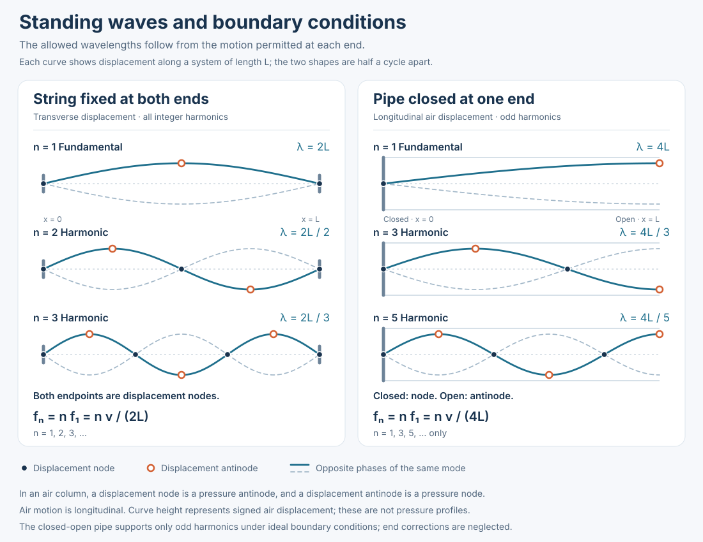

## Practice Exam PDFs

Open or download the original exams, including their supplied answer keys. Corrections are explained in the review below.

:::pdf src="../../files/courses/phsx220/practice-exam-a.pdf" title="Practice Exam A" download="220-Final Exam-Practice Exam A.pdf"

12 pages: questions on pages 1-6; supplied solutions on pages 7-12.
:::

:::pdf src="../../files/courses/phsx220/practice-exam-b.pdf" title="Practice Exam B" download="220-Final Exam-Practice Exam B.pdf"

14 pages: questions on pages 1-7; supplied solutions on pages 8-14.
:::

## Overview

PHSX 220 connects motion, forces, conservation laws, rotation, oscillations, and waves. This review follows the problems in [Practice Exam A (PDF)](../../files/courses/phsx220/practice-exam-a.pdf) and [Practice Exam B (PDF)](../../files/courses/phsx220/practice-exam-b.pdf), titled *Practice Final Exam 1* and *Practice Final Exam 2* inside the files. References below use **Exam A** and **Exam B** with their original question numbers.

The goal is to recognize the physical model, choose an equation, and explain why it applies. The longer problems in both exams repeatedly combine a diagram with several related calculations.

> [!TIP] Before substituting numbers
> Define the system, draw the forces or motion, choose axes or a pivot, and state the assumptions. Convert quantities to SI units. Use $g = 10\,\text{m/s}^2$ where the question specifies it.

## Exam Map

| Topic | Exam A | Exam B | Main task |
| --- | --- | --- | --- |
| Units and projectile motion | Q1-Q3 | Q6, Q8 | Separate horizontal and vertical motion |
| Circular motion | Q4 | Q3-Q4 | Find the inward net force and use the right-hand rule |
| Work, energy, and gravity | Q7-Q9 | Q1-Q2, Q9, Q11 | Track energy or apply inverse-square scaling |
| Collisions | Q10, Q13 | Q10 | Choose linear or angular momentum conservation |
| Torque and rotation | Q11-Q12, Q16 | Q16 | Locate forces, choose a pivot, and use the correct inertia |
| Angular momentum | Q17 | Q17 | Compare the system before and after its inertia changes |
| Oscillations and pendulums | Q5, Q14 | Q5, Q13, Q18 | Read amplitude, frequency, phase, and pivot geometry |
| Traveling and standing waves | Q6, Q18 | Q7, Q12, Q14, Q19 | Identify wave speed and boundary conditions |

Question 15 in each exam is a course-feedback question. The study topics above describe these two practice exams.

## 1. Units and Projectile Motion

Convert units before calculating: $1\,\text{g} = 10^{-3}\,\text{kg}$, $1\,\text{km} = 10^3\,\text{m}$, and $1\,\text{L} = 10^3\,\text{cm}^3$. For example, Exam A Q3 gives $5\,\text{L}/4 = 1250\,\text{cm}^3$ per shovelful.

With negligible air resistance and upward chosen as positive, projectile motion obeys

$$
x - x_0 = v_0\cos\theta\,t
$$

$$
y - y_0 = v_0\sin\theta\,t - \frac{1}{2}gt^2
$$

At the highest point, the **vertical velocity** is zero. Gravity still acts, so the acceleration is downward and the net force is $mg$ downward.

### Two Useful Patterns

- **Maximum height, Exam A Q1:** $v_{0y} = 200\sin 30^\circ = 100\,\text{m/s}$, so $h_{\max} = v_{0y}^2/(2g) = 500\,\text{m}$ above the launch point.
- **Horizontal launch, Exam B Q8:** a drop of $11.25\,\text{m}$ gives $t = \sqrt{2h/g} = 1.50\,\text{s}$. Crossing $12.0\,\text{m}$ therefore requires $v_x = 12.0/1.50 = 8.0\,\text{m/s}$.

For a horizontal launch at a fixed speed, the drop is proportional to flight time squared and therefore to horizontal distance squared. Halving the distance makes the drop one-quarter as large, as in Exam B Q6.

## 2. Forces and Circular Motion

:::reference Newton's second law
$$
\sum\vec{F} = m\vec{a}
$$

- `ΣF`: net external force on the object, in newtons.
- `m`: mass, in kilograms.
- `a`: acceleration, in metres per second squared.

For a constant-mass object in an inertial reference frame.
:::

In circular motion, the radial component becomes

$$
\sum F_{\text{inward}} = \frac{mv^2}{R}
$$

The term $mv^2/R$ describes the required **net inward force**. Draw the actual forces, such as tension and weight, before writing this equation.

At the bottom of the vertical swing in Exam A Q4, inward is upward:

$$
F_T - mg = \frac{mv^2}{R}
$$

If $F_T = 2mg$, then $v = \sqrt{gR}$. Omitting the weight would give the wrong speed.

In the horizontal-circle model of Exam B Q3, tension supplies the radial force, so $K = mv^2/2 = F_T R/2$. A breaking tension of $100\,\text{N}$ gives $K = (50\,\text{N})R$.

For angular velocity, curl the fingers of your right hand in the direction of motion; your thumb gives the axis direction. Angular velocity points along the rotation axis, while the instantaneous linear velocity is tangent to the circle.

## 3. Work, Energy, and Gravity

Use energy when the question connects heights, speeds, friction, or spring compression without needing the elapsed time:

$$
K_i + U_i + W_{\text{nc}} = K_f + U_f
$$

Here, $W_{\text{nc}}$ is work by nonconservative forces, such as kinetic friction. Useful expressions are

$$
K = \frac{1}{2}mv^2, \qquad U_g = mgy, \qquad U_s = \frac{1}{2}kx^2
$$

The expression $mgy$ assumes approximately constant gravity near a surface. A conservative force does path-independent work: $W_{\text{cons}} = -\Delta U$.

- **Hill into a spring, Exam A Q7:** if the mass starts and ends at rest with no friction, $mgh = kx^2/2$. Thus $k = 2mgh/x^2$, with $x = 3\,\text{m}$ in the problem.
- **Stopping by friction, Exam B Q9:** on a level floor, $N = mg$ and $W_f = -\mu_k mgd$. Hence $d = 15/(0.60\times5.0\times10) = 0.50\,\text{m}$.
- **Two hills, Exam B Q11:** $v = \sqrt{2g(h_i-h_f)} = \sqrt{140}\,\text{m/s} \approx 11.8\,\text{m/s}$. The mass cancels.

### Gravity Beyond the Constant-$g$ Model

For point masses or a spherically symmetric body viewed from outside:

$$
F_g = \frac{GMm}{r^2}, \qquad U(r) = -\frac{GMm}{r}, \qquad v_{\text{esc}} = \sqrt{\frac{2GM}{R}}
$$

The potential energy is zero at infinity. Increasing the separation from $d$ to $4d$ reduces the gravitational force to $1/16$ of its original value.

Using the values supplied in Exam A Q8, $M = 10^{22}\,\text{kg}$, $R = 1.2\times10^6\,\text{m}$, and $G = 6.7\times10^{-11}\,\text{m}^3/(\text{kg}\cdot\text{s}^2)$ gives $v_{\text{esc}} \approx 1.1\,\text{km/s}$. For Q9, giving a $1.0\,\text{g}$ object a speed of $11\,\text{km/s}$ requires $K = 60{,}500\,\text{J}$, approximately $61{,}000\,\text{J}$.

## 4. Momentum and Collisions

For negligible external impulse during a collision, the total linear momentum is conserved:

$$
\sum\vec{p}_i = \sum\vec{p}_f, \qquad \vec{p} = m\vec{v}
$$

| Collision type | Momentum, with negligible external impulse | Kinetic energy |
| --- | --- | --- |
| Elastic | Conserved | Conserved |
| Inelastic | Conserved | Not conserved |
| Perfectly inelastic: objects stick | Conserved | Generally decreases |

Exam A Q10 specifies an elastic collision, so the two-block system loses zero kinetic energy. In Exam B Q10, the blocks stick:

$$
(5.0\,\text{kg})v_i = (5.0+3.0)\,\text{kg}\,(10.0\,\text{m/s})
$$

Thus $v_i = 16\,\text{m/s}$. Conserving kinetic energy here would contradict the sticking collision.

For a collision involving a fixed pivot, consider **angular momentum about that pivot** instead. In Exam A Q13, the ball strikes perpendicular to the rod at radius $L/2$, so its incoming angular momentum magnitude is $mvL/2$. The pivot can exert an impulse while exerting zero torque about itself.

## 5. Torque, Equilibrium, and Rotational Dynamics

For a planar rigid body about a fixed axis:

$$
\tau = rF\sin\theta = Fd_{\perp}, \qquad \sum\tau = I\alpha
$$

The lever arm $d_{\perp}$ is the perpendicular distance from the pivot to the force's line of action. An extended free-body diagram must show where each force acts.

Static equilibrium requires both $\sum\vec{F} = 0$ and $\sum\tau = 0$. Choose a pivot through an unknown support force to remove its torque from the equation.

### Worked Example: The Supported Rod

In Exam A Q16, the uniform rod has mass $m$ and length $L$, and another mass $m$ hangs at its end. The cable attaches at the **midpoint**, making $30^\circ$ with the horizontal rod.

Taking counterclockwise torque as positive about the wall mount:

$$
(F_T\sin30^\circ)\frac{L}{2} - mg\frac{L}{2} - mgL = 0
$$

This gives $F_T = 6mg$. Vertical force balance then gives

$$
F_{\text{wall},y} + 3mg - 2mg = 0
$$

The wall's vertical force is therefore $mg$ **downward**. A support force need not point upward: its direction follows from the force balance.

### Off-Center Loads and Pivot Choice

For Exam B Q16, write the center of mass's horizontal distance from the left support as $a = 1.0\,\text{m}$. Torque and vertical force balance give

$$
F_R = \frac{Mga}{L}, \qquad F_L = Mg\left(1 - \frac{a}{L}\right)
$$

Keeping $a$ explicit preserves the units. The center of mass's vertical height does not enter the gravitational torque about the left support because gravity acts vertically.

### Moment of Inertia and Angular Acceleration

| Object and axis | Moment of inertia |
| --- | --- |
| Point mass at distance $r$ | $mr^2$ |
| Uniform rod about its center, perpendicular to its length | $ML^2/12$ |
| Uniform rod about one end, perpendicular to its length | $ML^2/3$ |
| Solid disk about its central symmetry axis | $MR^2/2$ |
| Uniform solid sphere about a diameter | $2MR^2/5$ |

For an axis parallel to one through the center of mass, use $I_P = I_{\text{cm}} + Md^2$. Once the axis is fixed, $\alpha = \tau_{\text{net}}/I_P$.

For the disk in Exam A Q11-Q12, $I = 0.50\,\text{kg}\cdot\text{m}^2$, $\alpha = (20-0)/2 = 10\,\text{rad/s}^2$, and $K_{\text{rot}} = I\omega^2/2 = 100\,\text{J}$.

:::details A modeling detail in Exam B Q16(c)
The supplied solution treats the left corner as a fixed pivot after the right support is released. Under that assumption, $d^2 = (1.0\,\text{m})^2 + (0.5\,\text{m})^2$ and $I_P = M(6.25\,\text{m}^2)$. The initial angular acceleration is $Mg(1.0\,\text{m})/I_P = 1.6\,\text{rad/s}^2$ clockwise, using $g = 10\,\text{m/s}^2$.

A fixed pivot must supply the reaction force needed to hold the corner in place. The problem's additional statement that the left force stays unchanged is inconsistent with that constraint; the fixed-pivot result relies on allowing that reaction to change.
:::

## 6. Angular Momentum and Changing Inertia

For rotation about the relevant fixed axis, $L_z = I\omega$. If the external torque about that axis is negligible:

$$
I_i\omega_i = I_f\omega_f
$$

Always include every object in the chosen system. Mechanical energy requires a separate check.

### Moving Inward: Exam A Q17

The disk has mass $3m$. Treating the cat as a point mass, its move from $R/2$ to the center changes the total inertia from

$$
I_i = \frac{1}{2}(3m)R^2 + m\left(\frac{R}{2}\right)^2 = \frac{7}{4}mR^2
$$

to $I_f = 3mR^2/2$. Thus $\omega_f = (7/6)\omega_i = 7/3\,\text{rad/s}$ for $\omega_i = 2.0\,\text{rad/s}$.

At fixed angular momentum, $K_{\text{rot}} = L_z^2/(2I)$. The decrease in inertia increases rotational kinetic energy, with $K_f/K_i = 7/6$. The cat supplies energy through internal work.

### Catching a Rotating Pole: Exam B Q17

For a pole of mass $5m$ pivoted at one end, $I_i = 5mL^2/3$. A child of mass $m$ grabs it at radius $2L/3$, giving

$$
I_f = \frac{5}{3}mL^2 + m\left(\frac{2L}{3}\right)^2 = \frac{19}{9}mL^2
$$

Therefore $\omega_f = (15/19)\omega_i$ and $K_f/K_i = 15/19$. Angular momentum is conserved about the pivot, while the inelastic capture reduces kinetic energy.

## 7. Oscillations and Physical Pendulums

For simple harmonic motion:

$$
x(t) = A\cos(\omega t+\phi)
$$

$$
v(t) = -A\omega\sin(\omega t+\phi), \qquad a(t) = -\omega^2x(t)
$$

The period is $T = 2\pi/\omega$, the frequency is $f = 1/T$, the maximum speed is $A\omega$, and the maximum acceleration magnitude is $A\omega^2$. The total distance traveled in one period is $4A$; the net displacement over that period is zero.

On a velocity-time graph, acceleration is the **slope**. Zero acceleration with negative velocity occurs at a negative velocity minimum, which is point D in Exam B Q13.

### Worked Example: Checking the Phase

Exam B Q18 gives $A = 6.0\,\text{m}$, $\omega = 3\pi\,\text{rad/s}$, and $\phi = \pi/3$. Consequently:

| Quantity | Value |
| --- | --- |
| Period | $2/3\,\text{s}$ |
| Frequency | $1.5\,\text{Hz}$ |
| Maximum speed | $18\pi\,\text{m/s}$ |
| Maximum acceleration magnitude | $54\pi^2\,\text{m/s}^2$ |
| Distance traveled in one period | $24\,\text{m}$ |

At $t = 2\,\text{s}$, the phase is $6\pi+\pi/3$, equivalent to $\pi/3$. Therefore:

$$
x(2\,\text{s}) = 3\,\text{m}
$$

$$
v(2\,\text{s}) = -9\sqrt{3}\pi\,\text{m/s}, \qquad a(2\,\text{s}) = -27\pi^2\,\text{m/s}^2
$$

> [!NOTE] Correction to the supplied answer key
> Exam B Q18's solution swaps the values of $\sin(\pi/3)$ and $\cos(\pi/3)$ when evaluating the motion at $2\,\text{s}$. The correct values are $\sqrt{3}/2$ and $1/2$, respectively; the results above follow directly from the stated equation.

### Physical Pendulums

For small angular oscillations of a rigid body about a horizontal pivot:

$$
T = 2\pi\sqrt{\frac{I_P}{Mgd}}
$$

Here $d$ is the pivot-to-center-of-mass distance. Find $I_P$ with the parallel-axis theorem before calculating the period.

- **Sphere hinged at its edge, Exam A Q5:** $I_P = 7MR^2/5$ and $d = R$, so $T = 2\pi\sqrt{7R/(5g)}$.
- **Disk pinned at its rim, Exam B Q5:** $I_P = 3MR^2/2$ and $d = R$, so $T = 2\pi\sqrt{3R/(2g)}$.

## 8. Traveling Waves and Standing Modes

A traveling wave of the form $y(x,t) = A\cos(kx-\omega t+\phi)$ moves in the positive $x$ direction, with

$$
v_{\text{wave}} = \frac{\omega}{k} = f\lambda, \qquad k = \frac{2\pi}{\lambda}
$$

This is the propagation speed of the pattern, distinct from the transverse velocity of a point on the string. Exam A Q6 gives $v_{\text{wave}} = 1/3\,\text{m/s}$; Exam B Q14 gives $\pi/10\,\text{m/s}$.

### Boundary Conditions Come First

| System | Displacement at the ends | Allowed wavelengths | Frequencies |
| --- | --- | --- | --- |
| String fixed at both ends | Node at each end | $\lambda_n = 2L/n$ | $f_n = nv/(2L)$, $n=1,2,3,\ldots$ |
| Ideal pipe closed at one end | Node at the closed end; antinode at the open end | $\lambda_n = 4L/n$ | $f_n = nv/(4L)$, $n=1,3,5,\ldots$ |

For sound in a pipe, pressure nodes and antinodes are opposite to displacement nodes and antinodes. The ideal pipe formulas neglect end corrections. Adjacent displacement nodes are $\lambda/2$ apart; a node and its nearest antinode are $\lambda/4$ apart.

### Closed-Open Pipe: Exam A Q18

With $v = 340\,\text{m/s}$ and $f_1 = 100\,\text{Hz}$:

$$
L = \frac{v}{4f_1} = 0.85\,\text{m}, \qquad \lambda_5 = \frac{4L}{5} = 0.68\,\text{m}
$$

The fifth harmonic's adjacent-node spacing is $\lambda_5/2 = 0.34\,\text{m}$.

> [!NOTE] Unit correction
> The Exam A Q18 solution prints the final spacing as $0.34\,\text{cm}$. Its preceding calculation gives **$0.34\,\text{m}$**, equivalent to $34\,\text{cm}$.

The well in Exam B Q12 follows the same ideal closed-open model: $f_1 = 340/(4\times85) = 1.0\,\text{Hz}$.

### String Tension: Exam B Q19

For a stretched string, use $v = \sqrt{F_T/\mu}$ with linear mass density $\mu = m_{\text{string}}/L$. A string with $L = 1.0\,\text{m}$ and $f_1 = 100\,\text{Hz}$ has $v = 2Lf_1 = 200\,\text{m/s}$. Its mass is $0.050\,\text{kg}$, so

$$
F_T = \mu v^2 = (0.050\,\text{kg/m})(200\,\text{m/s})^2 = 2000\,\text{N}
$$

At unchanged tension and linear density, halving the length doubles the fundamental frequency. Thus the frequency ratio in Exam B Q7 is $f_1/f_2 = 1/2$.

## Final Review Checklist

- [ ] Explain why gravity still acts at the top of a projectile's path.
- [ ] Draw actual forces before writing a radial-force equation.
- [ ] State when energy, linear momentum, or angular momentum is conserved.
- [ ] Locate every force on an extended free-body diagram and choose a useful pivot.
- [ ] Shift moment of inertia to the required axis before using $I\alpha$ or $I\omega$.
- [ ] Explain why rotational kinetic energy increases for the cat but decreases for the child catching the pole.
- [ ] Differentiate the SHM position equation and evaluate the phase in radians.
- [ ] Sketch the allowed standing modes and label displacement nodes and antinodes.

### Quick Self-Check

1. For the sphere pendulum, what happens to the period if the radius is multiplied by four?
2. In Exam A's pipe, what is the frequency of the next allowed mode above the fifth harmonic?
3. After an isolated rotating system halves its inertia, how do its angular speed and rotational kinetic energy change?

:::details Check your reasoning
1. The period doubles because $T$ is proportional to $\sqrt{R}$.
2. The next allowed mode is the seventh harmonic, with frequency $700\,\text{Hz}$.
3. Angular speed doubles by angular momentum conservation. Rotational kinetic energy also doubles because $K = L_z^2/(2I)$; the process changing the inertia must supply the energy.
:::

## Related Courses

- [Circuits I](../../notes/eele201.html)
- [Circuits II](../../notes/circuits-ii.html)
- [Physics II](../../notes/physics-ii.html)
